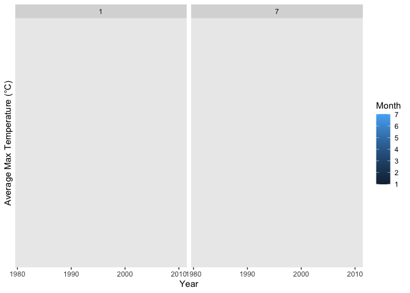
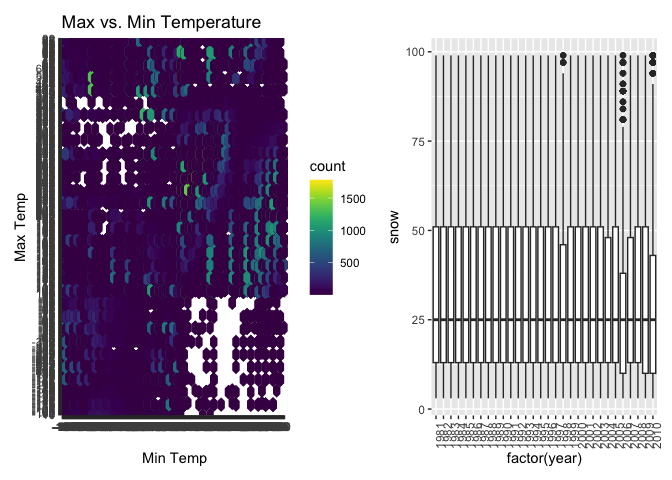
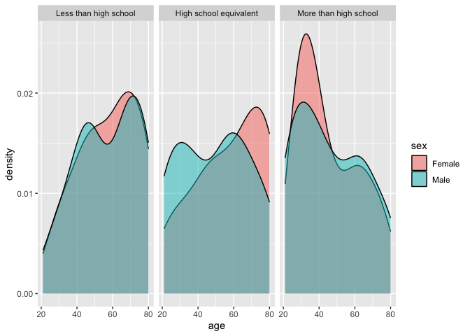
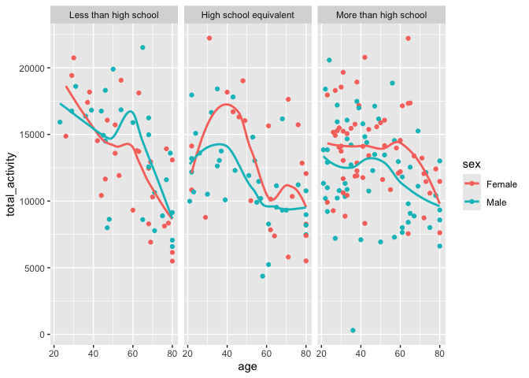
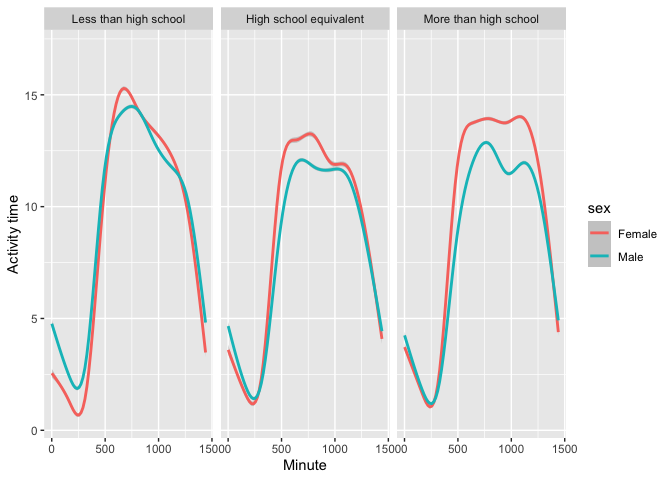
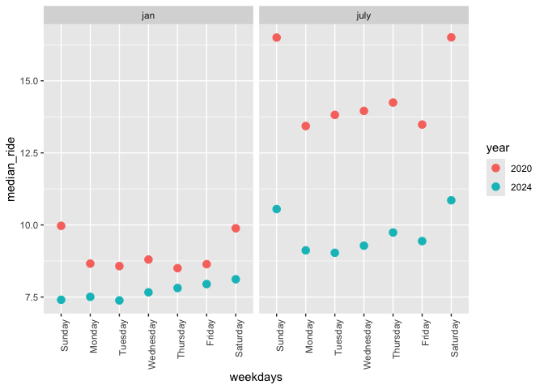
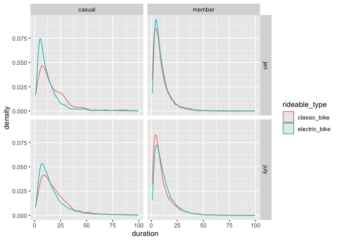

p8105_hw3_fs2968
================
2026-10-13

# Problem 1

First we load our data and necessary libraries.

``` r
library(tidyverse)
```

    ## ── Attaching core tidyverse packages ──────────────────────── tidyverse 2.0.0 ──
    ## ✔ dplyr     1.2.1     ✔ readr     2.2.0
    ## ✔ forcats   1.0.1     ✔ stringr   1.6.0
    ## ✔ ggplot2   4.0.3     ✔ tibble    3.3.1
    ## ✔ lubridate 1.9.5     ✔ tidyr     1.3.2
    ## ✔ purrr     1.2.2     
    ## ── Conflicts ────────────────────────────────────────── tidyverse_conflicts() ──
    ## ✖ dplyr::filter() masks stats::filter()
    ## ✖ dplyr::lag()    masks stats::lag()
    ## ℹ Use the conflicted package (<http://conflicted.r-lib.org/>) to force all conflicts to become errors

``` r
library(patchwork)
library(p8105.datasets)
data("ny_noaa")
```

This dataset `ny_noaa` shows the climate, including the amount of
precipitation, snowfall, and snow depth, and some identification
variables like id and date. There are a total of 7 variables and 2595176
data entries. In regards to the number of missing data entries, there
are a total of 3387623 values, which is 18.6479122 percent of the whole
dataset. Now, we can do some data cleaning,

``` r
ny_noaa_clean = ny_noaa |> 
  janitor::clean_names() |> 
  separate(date, into=c("year", "month", "day"), sep="-", remove=TRUE) |> 
  mutate(
    year = as.double(year),
    month= as.double(month),
    day = as.double(day)
  )
```

Looking at the data, we’ve made years, months, and days separate.
Looking at the observations for temperature, the values vary between -1
and 99, so the units are likely to be in Fahrenheit. For the
precipitation, we have a range from 0 and 22860, so it could be units
like cubic millimeters, or another small base unit. For snowfall, we
have one column for snow and one column for snwd, which likely implies
snow depth. The first observation might be new snow gained today and the
second may be total snow depth, but would require more clarification.
For snowfall, the most commonly observed value is 0, which makes sense
as most of the seasons do not have snowfall.

Next, we can make a plot showing the average max temperature in January
and in July in each station across years.

``` r
ny_noaa_clean |> 
  filter(month == 1 | month == 7) |> 
  group_by(year, month) |> 
  summarize(
    mean_tmax = mean(tmax, na.rm=TRUE), .groups= "drop"
  ) |> 
  ggplot(aes(x = year, y=mean_tmax, color=month)) + 
  geom_point() +
  geom_line() +
  labs(
    x = "Year",
    y = "Average Max Temperature (°C)",
    color = "Month"
  ) +
  facet_grid(. ~ month)
```

    ## Warning: There were 60 warnings in `summarize()`.
    ## The first warning was:
    ## ℹ In argument: `mean_tmax = mean(tmax, na.rm = TRUE)`.
    ## ℹ In group 1: `year = 1981`, `month = 1`.
    ## Caused by warning in `mean.default()`:
    ## ! argument is not numeric or logical: returning NA
    ## ℹ Run `dplyr::last_dplyr_warnings()` to see the 59 remaining warnings.

    ## Warning: Removed 60 rows containing missing values or values outside the scale range
    ## (`geom_point()`).

    ## Warning: Removed 60 rows containing missing values or values outside the scale range
    ## (`geom_line()`).

<!-- -->

As we can see, there are no observable structure or datapoints for any
max temperature in Janurary or July across each year.

Now, for a two-panel plat showing tmax and tmin for the full dataset:

``` r
plot1 = ny_noaa_clean |> 
  filter(!is.na(tmin), !is.na(tmax)) |> 
  ggplot(aes(x = tmin, y=tmax)) + 
  geom_hex(bins = 30) +
  viridis::scale_fill_viridis() +
  labs(
    title = "Max vs. Min Temperature",
    x = "Min Temp",
    y = "Max Temp",
  ) 

plot2 = ny_noaa_clean |>
  filter(!is.na(snow), snow > 0, snow < 100) |> 
  ggplot(aes(x=factor(year), y=snow)) +
  geom_boxplot() +
  theme(axis.text.x = element_text(angle = 90, hjust=1))
  
(plot1 + plot2)
```

<!-- -->

# Problem 2

We load, tidy, and organize the dataset below:

``` r
accel_data = 
  read_csv("data/nhanes_accel.csv",
            na = c("NA", ".", "")) |> 
  janitor::clean_names() |> 
  pivot_longer(
    min1:min1440,
    names_to= "minute",
    names_prefix = "min",
    values_to = "value"
  ) |> 
  mutate(
    minute = as.integer(minute)
  )
```

    ## Rows: 250 Columns: 1441
    ## ── Column specification ────────────────────────────────────────────────────────
    ## Delimiter: ","
    ## dbl (1441): SEQN, min1, min2, min3, min4, min5, min6, min7, min8, min9, min1...
    ## 
    ## ℹ Use `spec()` to retrieve the full column specification for this data.
    ## ℹ Specify the column types or set `show_col_types = FALSE` to quiet this message.

``` r
demo_data = 
  read_csv("data/nhanes_covar.csv",
           skip=4,
           na = c("NA", ".", "")) |> 
  janitor::clean_names() |> 
  mutate(
    sex = case_match(
      sex,
      1 ~ "Male",
      2 ~ "Female"
    ),
    sex = as.factor(sex),
    education = case_match(
      education,
      1 ~ "Less than high school",
      2 ~ "High school equivalent",
      3 ~ "More than high school"
    ),
  education = factor(
    education,
    levels=c("Less than high school", "High school equivalent", "More than high school")
  )) |> 
  filter(age >= 21) |> 
  drop_na(sex, age, bmi, education)
```

    ## Rows: 250 Columns: 5
    ## ── Column specification ────────────────────────────────────────────────────────
    ## Delimiter: ","
    ## dbl (5): SEQN, sex, age, BMI, education
    ## 
    ## ℹ Use `spec()` to retrieve the full column specification for this data.
    ## ℹ Specify the column types or set `show_col_types = FALSE` to quiet this message.

    ## Warning: There was 1 warning in `mutate()`.
    ## ℹ In argument: `sex = case_match(sex, 1 ~ "Male", 2 ~ "Female")`.
    ## Caused by warning:
    ## ! `case_match()` was deprecated in dplyr 1.2.0.
    ## ℹ Please use `recode_values()` instead.

``` r
accel_data = filter(accel_data, seqn %in% pull(demo_data, seqn))
```

To clean and tidy these datasets, we first load them in using `read_csv`
and then set the na values and skip rows if needed. Then, for the
accelerometer data, we use `pivot_longer` to change all of the column
names from min1 to min1440 to a single variable for minutes and a
separate column for the values, and ensure all of the typing is correct.
For the demographic data, we case match for the sex and then filter for
anyone under the age of 21 and with any NA demographic characteristics.
Lastly, we filter out the accelerometer dataset for anyone who was
removed from the demographic dataset.

Now we create a table for the number of men and women in the study in
each education category, and create a visualization of the age
distributions for men and women in each education category.

``` r
table1 = demo_data |> 
  mutate(
    ) |> 
  group_by(sex, education) |> 
  summarize(count = n()) 
```

    ## `summarise()` has regrouped the output.
    ## ℹ Summaries were computed grouped by sex and education.
    ## ℹ Output is grouped by sex.
    ## ℹ Use `summarise(.groups = "drop_last")` to silence this message.
    ## ℹ Use `summarise(.by = c(sex, education))` for per-operation grouping
    ##   (`?dplyr::dplyr_by`) instead.

``` r
table1 |> knitr::kable(digits = 1)
```

| sex    | education              | count |
|:-------|:-----------------------|------:|
| Female | Less than high school  |    28 |
| Female | High school equivalent |    23 |
| Female | More than high school  |    59 |
| Male   | Less than high school  |    27 |
| Male   | High school equivalent |    35 |
| Male   | More than high school  |    56 |

``` r
plot3 =  
  demo_data |> 
  ggplot(aes(x = age, fill=sex)) +
  geom_density(alpha=0.5) +
  facet_grid(. ~ education)

plot3
```

<!-- -->

Now we have created our table and plot. The table shows that there is
substantially more men and women who have received an education greater
than high school in our dataset, with women having an education lower
than high school slightly more than equivalent, and men having slightly
more equivalent to high school education than lower. The plot
additionally reveals that for women, there tend to me more older women
with less than a high school or equivalent education while for men,
there appears to be more older men with less than a high school
education, but a consistent age range for equivalent education. For both
men and women, there are much more younger people with a higher
education compared to the older people.

Now we can create another plot for total activity for each participant,
grouped by sex and education.

``` r
total_data = accel_data |> 
  group_by(seqn) |> 
  summarize(total_activity = sum(value, na.rm=TRUE), .groups = "drop")

demo_data |> 
  mutate(
    total_activity = pull(total_data, total_activity)
  ) |> 
  ggplot(aes(x=age, y=total_activity, color=sex)) +
  geom_point()+
  geom_smooth(se=FALSE) +
  facet_grid(. ~ education)
```

    ## `geom_smooth()` using method = 'loess' and formula = 'y ~ x'

<!-- -->

Looking at the table above, we can see that the for all three education
groups, the trend lines slope downwards, which makes sense as on
average, the older we get the less activity we can do. We could argue
that for the less than high school education group, the trend lines are
more steep than the other two groups, but I would hesitate to do so
given how large the point spread/variance is.

Lastly, we create a plot of 24 hour activity time course for each
education level, with color to indicate sex.

``` r
#twenty-four hour data
tf_data = accel_data |>
  inner_join(demo_data, by="seqn") |> 
  group_by(minute, sex, education) |> 
  summarize(mean_day = mean(value, na.rm = TRUE), .groups = "drop")

tf_data |> 
  ggplot(aes(x = minute, y=mean_day, color=sex)) +
  geom_point(alpha=0.0) +
  geom_smooth() +
  facet_grid(. ~ education) +
  labs(
    y = "Activity time",
    x = "Minute",
  )
```

    ## `geom_smooth()` using method = 'gam' and formula = 'y ~ s(x, bs = "cs")'

<!-- -->

We initially plot this as a point/scatter plot distirbution, but due to
the number of points and subsequent ambiguity, we change over to the
smooth curve approximation for better clarity. We can see that for the
education group, less than high school, the men and women activity time
is very similar over the day, with men perhaps having slightly more
activity early in the day. In the following two education groups, we can
see that women have a higher activity time during the middle sections of
the day, which is especially prominent in the more than high school
education group.

# Problem 3

We first import, clean, and tidy the data:

``` r
jan_2020 = 
  read_csv("data/citibike/Jan 2020 Citi.csv",
                    na = c("NA", ".", "")) |> 
  janitor::clean_names() |> 
  rename(status = member_casual) |> 
  mutate(
    month = "jan", 
    year = 2020
  )
```

    ## Rows: 12420 Columns: 7
    ## ── Column specification ────────────────────────────────────────────────────────
    ## Delimiter: ","
    ## chr (6): ride_id, rideable_type, weekdays, start_station_name, end_station_n...
    ## dbl (1): duration
    ## 
    ## ℹ Use `spec()` to retrieve the full column specification for this data.
    ## ℹ Specify the column types or set `show_col_types = FALSE` to quiet this message.

``` r
jan_2024 = 
  read_csv("data/citibike/Jan 2024 Citi.csv",
                    na = c("NA", ".", "")) |> 
  janitor::clean_names() |> 
  rename(status = member_casual) |> 
  mutate(
    month = "jan", 
    year = 2024
  )
```

    ## Rows: 18861 Columns: 7
    ## ── Column specification ────────────────────────────────────────────────────────
    ## Delimiter: ","
    ## chr (6): ride_id, rideable_type, weekdays, start_station_name, end_station_n...
    ## dbl (1): duration
    ## 
    ## ℹ Use `spec()` to retrieve the full column specification for this data.
    ## ℹ Specify the column types or set `show_col_types = FALSE` to quiet this message.

``` r
july_2020 = 
  read_csv("data/citibike/July 2020 Citi.csv",
                    na = c("NA", ".", "")) |> 
  janitor::clean_names() |> 
  rename(status = member_casual) |> 
  mutate(
    month = "july", 
    year = 2020
  )
```

    ## Rows: 21048 Columns: 7
    ## ── Column specification ────────────────────────────────────────────────────────
    ## Delimiter: ","
    ## chr (6): ride_id, rideable_type, weekdays, start_station_name, end_station_n...
    ## dbl (1): duration
    ## 
    ## ℹ Use `spec()` to retrieve the full column specification for this data.
    ## ℹ Specify the column types or set `show_col_types = FALSE` to quiet this message.

``` r
july_2024 = 
  read_csv("data/citibike/July 2024 Citi.csv",
                    na = c("NA", ".", "")) |> 
  janitor::clean_names() |> 
  rename(status = member_casual) |> 
  mutate(
    month = "july", 
    year = 2024
  )
```

    ## Rows: 47156 Columns: 7
    ## ── Column specification ────────────────────────────────────────────────────────
    ## Delimiter: ","
    ## chr (6): ride_id, rideable_type, weekdays, start_station_name, end_station_n...
    ## dbl (1): duration
    ## 
    ## ℹ Use `spec()` to retrieve the full column specification for this data.
    ## ℹ Specify the column types or set `show_col_types = FALSE` to quiet this message.

``` r
rides_data = bind_rows(jan_2020, jan_2024, july_2020, july_2024)
```

After importing the bike ride data for each month and year given, we
define our na values, clean the names, rename necessary variables to
more read-able values, and add a year and month column. Then we combine
all datasets into one dataset with 9 variables (cols) and 99485 rides
tracked (rows). We have both identification variables like ride_id,
rideable_type, weekdays and status, month, year, and we have ride
characteristic variables like duration, start_station_name,
end_station_name. The ride during is in minutes and the station names
are street intersections. The options for status are member and casual.

Below is a table showing the total number of rides in each combination
of year and month separating casual riders and Citi Bike members.

``` r
rides_data |> 
  group_by(year, month, status) |> 
  summarize(count = n()) |>  knitr::kable(digits = 1)
```

    ## `summarise()` has regrouped the output.
    ## ℹ Summaries were computed grouped by year, month, and status.
    ## ℹ Output is grouped by year and month.
    ## ℹ Use `summarise(.groups = "drop_last")` to silence this message.
    ## ℹ Use `summarise(.by = c(year, month, status))` for per-operation grouping
    ##   (`?dplyr::dplyr_by`) instead.

| year | month | status | count |
|-----:|:------|:-------|------:|
| 2020 | jan   | casual |   984 |
| 2020 | jan   | member | 11436 |
| 2020 | july  | casual |  5637 |
| 2020 | july  | member | 15411 |
| 2024 | jan   | casual |  2108 |
| 2024 | jan   | member | 16753 |
| 2024 | july  | casual | 10894 |
| 2024 | july  | member | 36262 |

In the table above, we can see that for each month, the number of member
rides greatly exceeds the number of casual rides. For example, in
January of 2020, we saw that 92.0772947 percent of rides were from
members. This makes sense as riders who rode more often were more likely
to be members, thus the higher total number. From 2020 to 2024, we can
also see a general increase in both the number of riders, which means
more people were using the bikes. We can also see that relative to each
year, the number of people using the bikes in July exceeds the number in
January, which makes sense as its warmer out and people are more likely
to bike.

In the table below, we show the 5 most popular starting stations for
July 2024:

``` r
top_5 = rides_data |> 
  filter(month == "july", year == "2024") |> 
  group_by(start_station_name) |> 
  summarize(num_rides = n()) |> 
  arrange(desc(num_rides)) |> 
  head(5)
top_5 |> knitr::kable(digits = 1)
```

| start_station_name       | num_rides |
|:-------------------------|----------:|
| Pier 61 at Chelsea Piers |       163 |
| University Pl & E 14 St  |       155 |
| W 21 St & 6 Ave          |       152 |
| West St & Chambers St    |       150 |
| W 31 St & 7 Ave          |       146 |

As we can see in the table above, the ordering of the top five most
popular starting stations were Pier 61 at Chelsea Piers, University Pl &
E 14 St, W 21 St & 6 Ave, West St & Chambers St, W 31 St & 7 Ave with
the number of rides at each station being 163, 155, 152, 150, 146
respectively.

Now we can make a plot that looks at the effects of day of the week,
month, and year on median ride duration:

``` r
rides_data |> 
  filter(!is.na(duration), !is.na(weekdays)) |>
  mutate(
    weekdays = factor(
      weekdays,
      levels=c("Sunday", "Monday", "Tuesday", "Wednesday", "Thursday", "Friday", "Saturday")
    ),
    year = as.character(year)
  ) |> 
  group_by(weekdays, month, year) |> 
  summarize(median_ride = median(duration, na.rm=TRUE), .groups="drop") |> 
  ggplot(aes(x = weekdays, y= median_ride, color=year)) +
  geom_point(size=3) +
  facet_grid(. ~ month) +
  theme(axis.text.x = element_text(angle = 90, hjust=1))
```

<!-- -->

As we can see in the plot above, for each month and each year, the
weekends (Saturday and Sunday) all seem to have a jump in median rides,
which is understandable seeing that it is when most people are not in
work, and thus have time for more leisure activities. Surprisingly, we
see that July 2020 has a increase in overall median rides compared to
our other three time periods, which could be related to the height of
the pandemic, where people were looking for outside activities that were
within the boundaries of social distancing. The other three time periods
have similar patterns and median rides, with january 2020 and 2024 being
slightly lower than the july 2024, which could be due to the colder
weather.

Lastly, we have a figure that shows the impact of month, membership
status, and bike type on the distribution of ride duration:

``` r
rides_data |> 
  filter(year== "2024", !is.na(duration), duration < 100) |> 
  ggplot(aes(x=duration, color=rideable_type)) +
  geom_density() +
  facet_grid(month ~ status)
```

<!-- -->

Taking a look at these plots, we can see that for casual members, they
often took longer duration rides, for both the electrical and classic
bikes. Even more so, we can see a slightly lower density at smaller
durations for the classical bikes and higher densities for the medium
duration. For the members, we can see they mostly took shorter rides,
for both electrical bikes and classic bikes, and a similar overall
density distribution between the two bike types. This makes sense as
with a membership and lower costs per bike ride, they are more inclined
to take short bike rides instead of maximizing the duration to cost
ratio as a non-member would. Between July and January, there are small
differences, but nothing large enough that I would note it as
statistically significant.
